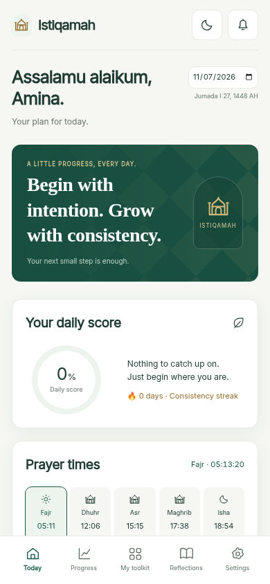
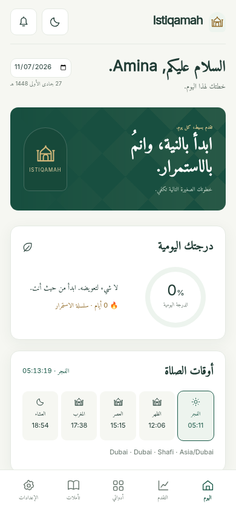
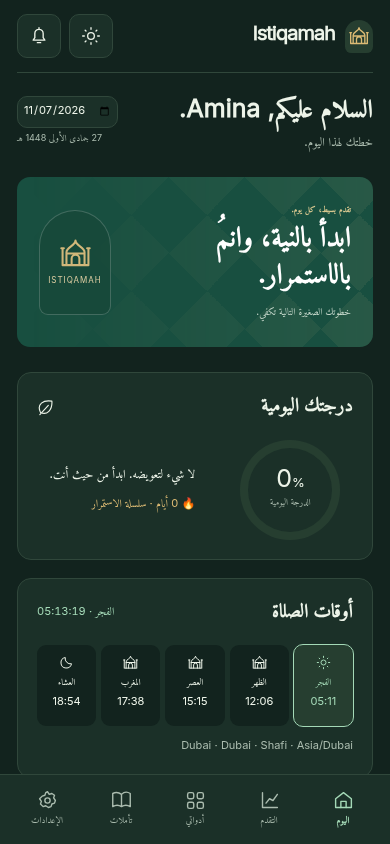
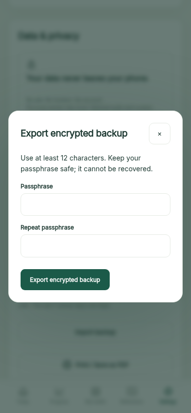

# Istiqamah

**Small deeds. Every day. Limitless results.**

### 🌐 Try it now: **[riyadhali66.github.io/Istiqamah](https://riyadhali66.github.io/Istiqamah/)**

Free, with no login and no ads. Works offline after the first visit. Available in English, العربية, اردو, മലയാളം and हिन्दी.

A private, local-first Muslim life companion. The entry HTML, readable ES modules in `js/`, and styles in `css/app.css` have no build step. Small companion files provide installable PWA support, local fonts, libraries, and attributed offline religious content. No login, application backend, AI API, build step, or runtime package installation is required.

## 🤝 Help improve Istiqamah

Istiqamah is free and open source. We hope it becomes sadaqah jariyah for everyone who helps build it. You don't need to be a programmer to contribute:

- **Use it and give feedback:** try it for a week and [share what to improve](../../issues/new/choose).
- **Check the religious content:** report any wrong reference, grade or count with your source. These reports get top priority.
- **Translate:** improve the Arabic, Urdu, Malayalam or Hindi text, or add a new language.
- **Test on your phone:** Android and iPhone reports with screenshots help a lot.
- **Write code:** fix bugs, improve accessibility, or help with v2 (accounts, cloud sync, push notifications).
- **Star ⭐ the repository and share it** with someone who could benefit.

Please read [CONTRIBUTING.md](CONTRIBUTING.md) before opening a pull request. JazakAllahu khairan 🤲

## Open it

From this directory:

```sh
python3 -m http.server 8000
```

Open `http://localhost:8000` on the same computer. Alternatively, serve this directory with any static web server. Use HTTPS for a phone or a deployed site. Do not open a development server to the public Internet.

ES modules require a static HTTP server; direct `file://` opening is no longer supported. Service workers, encryption and phone installation require HTTPS or localhost. Browser storage is scoped to the address you open; export and import a backup when moving between file, localhost, and a deployed address.

## Update an existing localhost copy

A GitHub push does not update a folder you downloaded earlier. Download the latest `main` ZIP and extract it, or run `git pull` in a Git clone. Stop the old Python server, start it from the updated folder using the same port, and reopen the exact same address (`http://localhost:8000/`). Reload once, wait briefly for the new offline worker, then reload again if the old interface remains. Do not clear site data: the personal records belong to the browser origin and survive replacement of application files. Export a backup before switching addresses or ports.

## Install on a phone

The app is live at **https://riyadhali66.github.io/Istiqamah/**, deployed with GitHub Pages from the `main` branch.

1. **Open the link on your phone:** use **Google Chrome** on Android or **Safari** on iPhone.
2. **Install it:**
   - **Android (Chrome):** tap the **three dots (⋮)** at the top right → **Install app** (or **Add to Home Screen**).
   - **iPhone (Safari):** tap the **Share** icon (square with an up arrow) at the bottom → **Add to Home Screen**.
3. **Open Istiqamah from your home screen.** It opens full-screen with no address bar. Choose your language (English, العربية, اردو, മലയാളം or हिन्दी) in the setup wizard or later in **Settings**.

Stay online the first time you open it, so the offline cache can finish. After that, the app works offline.

To host your own copy, serve the **entire directory**, including `vendor/` and `data/`, from any HTTPS static host.

After installation, reopen it from the home screen. The app, prayer calculations, Hijri calendar, charts and all licensed bundled readings work offline. Adhkar and the two adhan recordings are separate, explicit Settings downloads with a licensing notice; after downloading they also work offline. Existing adhkar counters are kept even without the download. Verse recitation streams from EveryAyah when first played and is cached when the browser permits. External commentary links need a connection.

## Save the tracker as a PDF

Open **Progress**, choose a month, then select **Print / Save as PDF**. Alternatively, use the button in Settings. Choose **Save as PDF**, **A4**, **landscape**. The first page is the personalized month tracker, followed by a monthly summary. For large habit lists, the browser may paginate the tracker across additional pages. Buttons and navigation are hidden. This exports the selected month's records, not example data.

## What works

- Eight skippable onboarding steps; English, Arabic, Urdu, Malayalam, and Hindi interfaces (with RTL layout for Arabic/Urdu and LTR for English/Malayalam/Hindi); ranked goals, individual goal descriptions, children, work situation, struggles, faith practices, daily rhythm, optional debts, and three commitment levels.
- Local rule-based plans for debt repayment, business development, job searching, study, health, language learning, parenting, stress, sleep, and faith. The five prayers have separate check-ins and count as one habit group when describing commitment levels. Gentle has five groups, Balanced ten, and Full power at least fifteen groups.
- Local Adhan JS prayer calculations using city presets, manually entered coordinates, or optional device geolocation; country-appropriate method suggestions, Shafi/Hanafi Asr, explicit IANA timezone, and next-prayer countdown. No location is transmitted to a prayer API.
- Daily numeric and checkbox habits, water glasses, mood and stress, journal entries, prayer/fasting pauses, weighted scores, actual streaks, and optional habit suggestions after seven active days. Prayer weights are three times ordinary habits. Scores use capped completion ratios. Paused prayer/fasting habits are excluded, and paused prayer days preserve existing prayer streaks.
- Editable, addable, removable habits; reorder controls; historical habit snapshots; editable schedule block labels and times, additional blocks, and removal. Schedule order follows the selected times; prayer blocks continue to follow actual prayer calculations.
- Multiple months, a real calendar-length heatmap, five weekly summaries, line/radar/mood-sleep charts, milestones, monthly reviews, and next-month goals. Empty history is shown as empty rather than simulated achievements. Week 5 includes all remaining days after day 28.
- Debt balances, payment histories with overpayment checks, savings goals, gold-based nisab and zakat estimates.
- Tasbih with a morning/evening adhkar picker, complete Arabic source text and references, automatic source repetition targets, next-dhikr navigation, and daily counts shared with Reflections; free counting retains 33/100 milestones, optional vibration and a linked faith habit; morning/evening adhkar with original repeat counts; fasting calendar, White Days, Ashura, Arafah, six Shawwal days, and next-day fasting prompts. Eid days and the days of Tashriq cannot be marked through the optional fasting calendar; Ramadan does not receive voluntary-fasting suggestions. Local moon-sighting dates can differ from Umm al-Qura. Arafah advice is for non-pilgrims; consult a scholar about your own circumstances.
- Individual child star charts, Quran minutes, and parent-set rewards; word log and reveal/review cards; a 25-minute focus timer; calendar exports for one or seven days with UTC timestamps and five-minute reminders.
- Plain JSON and optional encrypted backup export, validated legacy/encrypted import with confirmation and an undo copy before replacement, seven daily local safety copies, plan regeneration, re-onboarding, light/dark themes, installable offline shell, and a dedicated print layout.

## Religious content and exact boundaries

Religious text is copied from the requested source datasets, never generated. The `data/*.json` files bundle 15 curated Quran references in Arabic, English (Abdel Haleem), and Urdu (Fateh Muhammad Jalandhry); 60 thematic Sunan Abi Dawud references with explicit **Sahih or Hasan** source grades and grader names, in three languages; 99 names from Names of Allah JSON. Hadith references and grading remain linked to their Sunnah.com pages. Attribution and retrieval details are in `SOURCE-NOTICES.md`.

Azkar DB is no longer bundled: Settings offers a credited, checksum-verified download of its 61 original morning/evening entries, with a notice that no explicit license was found. The names dataset supplies **Arabic meanings only**. Those meanings and the original adhkar remain in Arabic in all interfaces, with a source-language label; this release does not invent English or Urdu religious translations. Quran commentary opens the appropriate Quran.com tafsir page; commentary text is not bundled. There is no in-app tafsir API integration in v1.

`hadithService` exposes the bundled open-data provider and a future server-provider interface. The Sunnah.com provider is inactive until a separately implemented server endpoint exists. No API key is present or requested by this frontend. A future server must keep `X-API-Key` private and enforce the same grade checks. There is no account/cloud-sync/push-notification backend in this version.

Browser notifications and adhan reminders work **only while the app is open**; browsers can suspend background tabs and require an initial tap for audio. Silent is the default. Export the calendar for reminders managed by a calendar application. Devices control vibration and installation availability.

## Privacy and backups

Personal profiles, coordinates, plans, financial entries, children, words, and journals stay in `localStorage`. No analytics, ads, telemetry, geocoding, or remote personal-data requests are included. Fonts, bundled religious data, charts and prayer calculations are local assets. Adhkar/adhan downloads contact GitHub only after an explicit tap; downloaded files stay in local IndexedDB. Optional Quran refresh and EveryAyah recitation reveal the normal request metadata/IP address to their providers; commentary links open external sites. The promise concerns personal app entries, not network anonymity.

Local browser storage, automatic safety copies and plain JSON exports are **not encrypted**. Settings → Export encrypted backup protects that exported file using AES-256-GCM and a PBKDF2-SHA256 key (310,000 iterations) with a unique random salt and nonce. Use at least 12 characters and store the passphrase separately; it cannot be recovered. Settings → Import backup accepts either format and asks for the encrypted file’s passphrase. Use a trusted device/browser profile. Clearing site data, uninstalling, or private-browsing cleanup can remove records. Export backups regularly and store them privately. Import/restore replaces current local records only after confirmation and a successful undo checkpoint. Settings → Restore a previous day lists seven recent active-day copies and recent undo/migration copies. Dates when the app was closed have no new snapshot. There are no external deletion or account operations.

## Code structure

- `index.html`: semantic shell, local vendor loaders and `js/app.js` module entry.
- `css/app.css`: calm responsive light/dark styles.
- `js/prayer.js`, `hijri.js`, `quran.js`, `hadith.js`, `adhkar.js`: existing services.
- `js/config.js`, `dates.js`, `engine.js`, `records.js`: defaults, calendar keys, plans and scoring.
- `js/storage.js`, `snapshots.js`, `backup-crypto.js`: compatible persistence, migration, undo/daily copies and encrypted files.
- `js/content.js`, `optional-content.js`: lazy licensed readings and explicit optional downloads.
- `js/ui/`: one renderer per screen, common controls, onboarding, charts and backup/download workflows.
- `js/i18n/{en,ar,ur,ml,hi}.json`: interface catalogs with identical keys; Arabic and Urdu use RTL.
- `js/app.js`: startup and event wiring; `js/session.js`: transient shared session state.
- `tests/browser.cjs`, `tests/phase1.cjs`: offline, recovery and regression checks; `tests/optional.cjs`: separate upstream-download integration.

`window.Istiqamah` retains the existing service/test interface. Personal data stays under `istiqamah.v1`, with `version: 1` retained and `schemaVersion: 1` added. The original bytes are backed up under `istiqamah.migration.v1` **before** upgrading. Unknown/corrupt records enter recovery and cannot be overwritten by ordinary saves. See [the audit and complete storage contract](docs/PHASE-1-AUDIT.md).

`sw.js` caches the complete shell and bundled data. Increment its cache version when shipping changed assets; reload after the new worker is installed. Online page reloads request fresh HTML and update the cached offline copy. Settings → Install app → Check for updates also checks the worker and reloads. Offline personal data persists independently of the shell cache.

## Development and tests

Node 18+ and Python 3 are sufficient. The application itself needs neither npm nor Node.

```sh
npm ci
# If Chromium is not already installed:
npx playwright install chromium
npm test
```

Tests use `/usr/bin/chromium` when present, or Playwright's installed Chromium. Set `CHROMIUM_PATH` to override. The runner starts its own local static server on port 8765 (override with `TEST_PORT`) and uses a fresh browser profile, leaving personal browser data untouched. It checks onboarding, personalization, prayer/timezone calculations, scoring, pauses, historical snapshots, escaping, debts, zakat, words, children, tasbih, adhkar, fasting dates, ICS downloads, backups, print pages, translations, mobile overflow, source completeness, and offline reloads.

## Added to fill practical gaps

- **Explicit timezone and manual coordinates:** makes location permission optional and keeps prayer times consistent when exporting calendars.
- **Historical habit snapshots:** changing a target today does not rewrite an earlier month's score.
- **Input validation, payment limits, and import confirmation:** protects existing records from malformed backups and accidental replacement.
- **Focus timer and recorded Quran minutes for children:** turns study and family intentions into measurable daily actions.
- **Cached licensed fonts/data and separate optional downloads:** the central daily workflow survives a lost connection without third-party scripts.
- **Moon-sighting and reminder explanations:** makes the calendar's source and browser limitations visible where users need them.

## Phase 1 status and validation

This is **1.1.0-phase1**, the first of the requested sequential phases; the live site is not changed by this local source delivery. Ramadan Mode, deeper faith features, motivation/languages and the cloud foundation remain subsequent phases. [CHANGELOG.md](CHANGELOG.md) records those boundaries.

The baseline had 23 passing checks. The expanded suite has **34 Chromium browser checks**, including legacy migration, backup-write failures, corrupt/future-schema preservation, stale-tab conflicts, encrypted export/import and tampering, seven-copy retention, confirmed restore/undo, recovery failure, identical translation keys, Arabic religious fallback, 390px layouts and offline modules/readings. The separate `npm run test:optional` downloads the three pinned upstream files, verifies their checksums, checks offline access/removal and confirms existing counters survive. It requires network access and `curl`; the ordinary test suite uses no external sacred-text fixtures.

Lighthouse mobile simulation on a local static server with gzip and a 10-minute asset cache measured **95 performance, 100 accessibility, 100 best practices, 100 SEO**. The plain Python development server, which serves uncompressed files, measured 86 performance. These are local lab measurements, not a guarantee for every device or the live deployment. Lighthouse's current release has no PWA scoring category; the browser suite directly checks worker installation, cached files and offline interactions. Recheck the deployed GitHub Pages URL after release.

## Screenshots

Current Chromium captures at 390 × 844 (sample profile):

| Today | Arabic RTL | Dark mode | Encrypted backup |
| --- | --- | --- | --- |
|  |  |  |  |

## Safely release and test on a phone

1. Export a backup from the current live app before releasing. Keep the GitHub Pages origin/path unchanged so existing browser storage remains available.
2. Review the Phase 1 commit, then merge/push it to `main` when ready. GitHub Settings → Pages should continue to deploy from **main / (root)**; serve the entire repository, including `js/`, `css/`, `data/` and `vendor/`. No build or backend setup is required.
3. On your phone, open the existing live URL in Chrome (Android) or Safari (iPhone). Settings → Check for updates, then reopen the app. Do not clear site data. Confirm the same name, habits and history are present; the schema upgrade is automatic.
4. In Settings, export an encrypted backup, then import it using its passphrase. Confirm only after reviewing the replacement notice. Open Restore a previous day and verify a safety copy is listed.
5. Wait for “Offline app cached”, turn on airplane mode, reopen, log one habit and view Progress. Try Arabic/Urdu and dark mode. Optional adhkar/recordings require a separate online download before they work offline.
6. No Supabase, Vercel, API keys or account settings are needed for Phase 1. It adds no sync and no real background push notifications.

## License

The Istiqamah application code is released under the [MIT License](LICENSE). Third-party libraries, fonts, religious texts and audio in `vendor/` and `data/` keep their own licenses and terms, as listed in [SOURCE-NOTICES.md](SOURCE-NOTICES.md).
